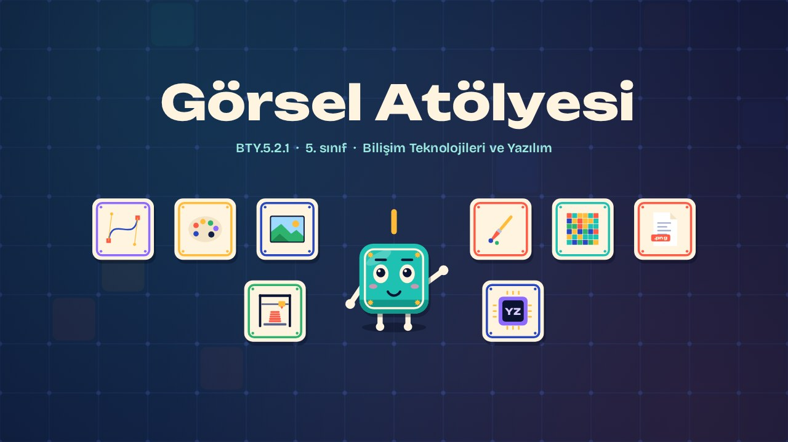
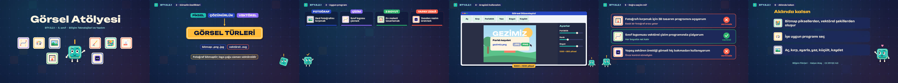

# Görsel Atölyesi · The Picture Workshop

**▶ Tarayıcıda izleyin / Watch in the browser:** https://hakanatas.github.io/gorsel-atolyesi/ 
**⬇ MP4 + altyazılar / MP4 + subtitles:** [Releases](https://github.com/hakanatas/gorsel-atolyesi/releases) 
**✎ Kullanılan istem / The prompt behind it:** [PROMPT.md](PROMPT.md) 
**🎞 Bütün filmler / All films:** [Bilişim Filmleri](https://hakanatas.github.io/bilisim-filmleri/?sinif=5)

> **TR —** 5. sınıf Bilişim Teknolojileri ve Yazılım dersinin "Dijital Ürün Tasarımı ve Geliştirme" temasındaki BTY.5.2.1 öğrenme çıktısı için hazırlanmış, tamamen JavaScript ile çizilen 2,2 dakikalık animasyon; ses efektleri ve hafif fon müziği de kodla üretilir. Görsellerin temel özellikleri tanıtılır: piksel, çözünürlük, bitmap ve vektörel görsel. Yapılacak işe göre uygun program seçilir: fotoğraf düzenleme, çizim, üç boyutlu tasarım ya da yapay zekâ destekli araç. Bir görsel düzenleme programında fotoğraf açılır, kırpılır, parlaklığı ayarlanır, yazı eklenir, boyutu küçültülür ve kaydedilir. Son olarak program seçimleri kullanım alanı ve verimlilik açısından değerlendirilir. Altyazılar Türkçe, İngilizce ya da ikisi birlikte seçilebilir.

A 2.2-minute animation, with code-generated sound, for **5th-grade IT and Software** (Türkiye Yüzyılı Maarif Modeli). Pixels, resolution, bitmap and vector images are introduced; the right program is chosen for each job; Karo opens, crops, brightens, labels, resizes and saves a photo; and program choices are judged for purpose and efficiency. The guide is **Karo**, a living glazed tile who never speaks: he tells the story with his face, his arms and the blinking cursor above his head.

## Öğrenme çıktısı · Learning outcome

MEB, Türkiye Yüzyılı Maarif Modeli, Bilişim Teknolojileri ve Yazılım Dersi Öğretim Programı, 5. sınıf, 2. tema "Dijital Ürün Tasarımı ve Geliştirme":

**BTY.5.2.1. Görsel düzenleme programlarından yararlanabilme**
- a) Görsellerin temel özelliklerini tanır.
- b) Uygun görsel düzenleme programını belirler.
- c) Belirlenen görsel düzenleme programının arayüz özelliklerini kullanır.
- ç) Kullanılan görsel düzenleme programını kullanım alanları/verimliliği açısından değerlendirir.

## Sahneler · Scenes

| # | Zaman | Sahne | Ne oluyor | Çıktı |
|---|---|---|---|---|
| 1 | 0:00–0:15 | Giriş |  |  |
| 2 | 0:15–0:45 | Görselin özellikleri | Piksel, çözünürlük, bitmap ve vektörel görsel. | a |
| 3 | 0:45–1:07 | Uygun program | Yapılacak işe göre fotoğraf, çizim, üç boyutlu ya da yapay zekâ destekli program seçilir. | b |
| 4 | 1:07–1:35 | Arayüzü kullanalım | Aç, kırp, parlaklık, yazı ekle, boyutlandır ve kaydet. | c |
| 5 | 1:35–1:58 | Doğru seçim mi? | Program seçimleri kullanım alanı ve verimlilik açısından değerlendirilir. | ç |
| 6 | 1:58–2:13 | Aklında kalsın |  |  |

## Çalıştırma · Running it

- **Önizleme:** `index.html` dosyasına çift tıklayın (çevrim dışı da çalışır). Klavye: boşluk oynat/duraklat, ← → 3 sn, Home başa. Adrese `?altyazi=en`, `?bicim=vertical` ya da `?ses=0` eklenebilir.
- **MP4:** bir kez `npm install`, sonra `npm run export -- --format=both --captions=tr` (720p yatay ve dikey, sesli). Google Chrome yüklüyse Playwright onu kullanır (`channel: 'chrome'`); ffmpeg gerekir.
- **Altyazı ve seslendirme notları:** `npm run srt` → `out/gorsel-atolyesi_tr.srt`, `_en.srt`, `_tr-en.srt`, `_seslendirme-notlari.txt`.
- **Sürüm dosyaları:** `npm run release` → `release/` klasöründe v1.0'ın 6 dosyası.
- **Yazı kontrolü:** `npm run check` yatay ve dikey düzende, üç altyazı seçeneğiyle üst üste binen, kenardan taşan ya da 720p'de 17 pikselden küçük kalan yazı arar.
- **Düzenleme:** senaryo (sahneler, altyazılar, seslendirme notları) `scenes/film.js` içindedir; değiştirince `npm run build` süreleri, `captions.js` ve `film.config.js` dosyalarını yeniden üretir. Sahne şablonları `src/kit/`, Karo `src/draw/karo.js`, ses `src/audio/synth.js`.

Her kare `renderFrame(t)` ile zamanın saf fonksiyonu olarak çizilir; rastgelelik tohumludur, MP4 ekran kaydı değil kare kare üretimdir. Ses de dosyadan çalınmaz: aynı olay listesinden hesaplanır. Yazı tipleri: Unbounded ve Bricolage Grotesque (SIL OFL 1.1), dosyaya gömülü.

## Lisans · License

**TR —** Bu film ve kodu [Creative Commons Atıf-GayriTicari 4.0 Uluslararası (CC BY-NC 4.0)](https://creativecommons.org/licenses/by-nc/4.0/deed.tr) lisansıyla paylaşılır. Ticari olmayan her amaçla (derste, okulda, eğitim materyalinde) kopyalayabilir, paylaşabilir ve değiştirebilirsiniz; ancak **kaynak göstermek zorunludur**: eser sahibinin adı ve bu deponun bağlantısı belirtilmeden kullanılamaz. Ticari kullanım (satış, ücretli ürün ya da yayın) için izin alınmalıdır.

**EN —** This film and its code are licensed under [Creative Commons Attribution-NonCommercial 4.0 International (CC BY-NC 4.0)](https://creativecommons.org/licenses/by-nc/4.0/). You may copy, share and adapt them for non-commercial purposes, but **attribution is required**: they may not be used without crediting the author and linking to this repository. Commercial use requires permission.

Atıf örneği / Required credit: *“Görsel Atölyesi”, Hakan Ataş, Bilişim Filmleri — https://github.com/hakanatas/gorsel-atolyesi — CC BY-NC 4.0*
